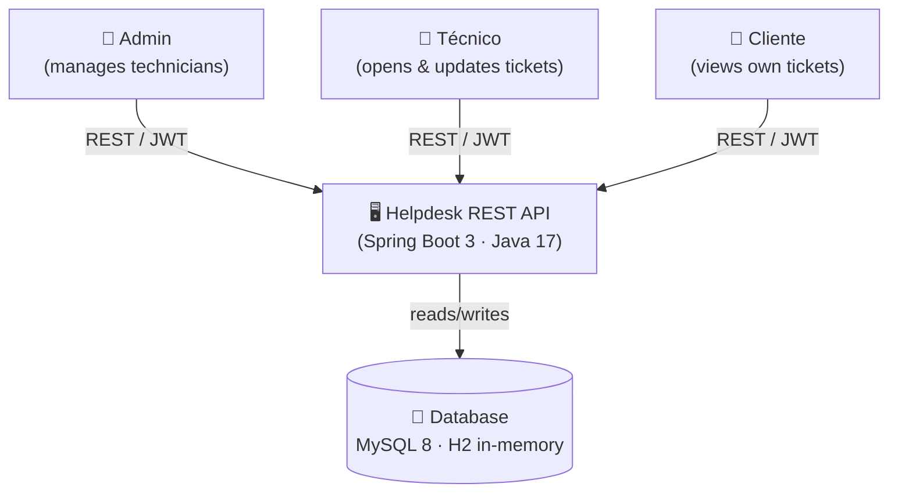
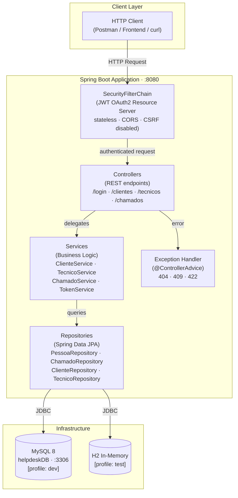

# Architecture

## Overview

**Helpdesk REST API** is a Spring Boot 3 RESTful application that manages support tickets (_chamados_) between clients (_clientes_) and technicians (_técnicos_). Authentication is handled via self-issued JWT (HMAC-HS512), and authorization is role-based using Spring Security method-level annotations.

---

## C1 — System Context

Shows the system as a black box and who interacts with it.

> **External actors**
> | Actor | Description |
> |---|---|
> | Admin | Creates and manages technicians |
> | Técnico | Opens, lists and updates support tickets; reads client data |
> | Cliente | Self-registers (no auth required); views and manages own data and tickets |

---

## C2 — Container Diagram

Opens the system box and shows the internal containers (processes / runtimes).

---

## Technology Stack

| Layer | Technology |
|---|---|
| Language | Java 17 |
| Framework | Spring Boot 3.1.0 |
| Security | Spring Security OAuth2 Resource Server · JWT (HMAC-HS512) |
| Persistence | Spring Data JPA · Hibernate |
| Database (dev) | MySQL 8 |
| Database (test) | H2 in-memory |
| API Docs | SpringDoc OpenAPI 2.6.0 (`/swagger-ui.html`) |
| Build | Maven Wrapper (`./mvnw`) |
| Containerization | Docker · Docker Compose |
| Orchestration | Kubernetes (Magalu Cloud) |
