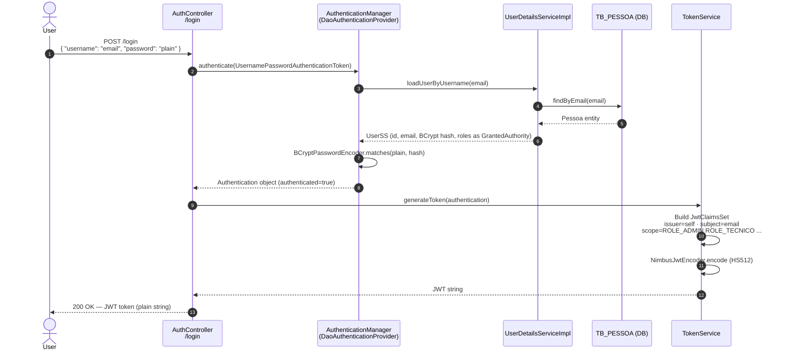
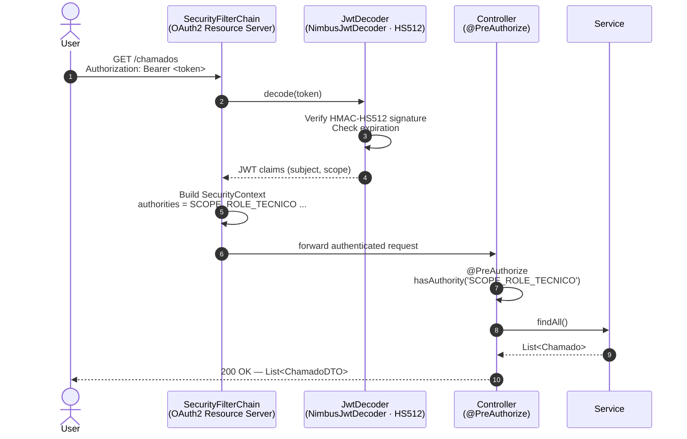

# Authentication & Authorization

## Overview

The API uses **stateless JWT authentication** based on Spring Security OAuth2 Resource Server. Tokens are self-issued (no external authorization server), signed with **HMAC-HS512** using a symmetric secret key configured via `jwt.secret`.

There are no sessions or cookies — every request must carry a valid `Bearer` token in the `Authorization` header (except the public endpoints listed below).

---

## Public Endpoints (no token required)

| Method | Path | Description |
|---|---|---|
| `POST` | `/login` | Authenticate and receive a JWT |
| `POST` | `/clientes` | Self-register as a new client |
| `GET` | `/swagger-ui.html` | API documentation UI |
| `GET` | `/v3/api-docs/**` | OpenAPI spec |
| `GET` | `/actuator/health` | Health check probes |

---

## Login Flow — Sequence Diagram



---

## Authenticated Request Flow



---

## JWT Token Structure

```
Header:  { "alg": "HS512" }
Payload: {
  "iss": "self",
  "sub": "user@email.com",
  "iat": <issued-at>,
  "exp": <expires-at>,
  "scope": "ROLE_ADMIN ROLE_TECNICO ROLE_CLIENTE"
}
```

> **`SCOPE_` prefix:** Spring Security OAuth2 Resource Server automatically prefixes each value in the `scope` claim with `SCOPE_` when building the `SecurityContext`. This is why `@PreAuthorize` uses `'SCOPE_ROLE_TECNICO'` rather than `'ROLE_TECNICO'`.

---

## Role → Endpoint Authorization Matrix

| Role | Can access |
|---|---|
| `ROLE_ADMIN` | `POST /tecnicos` · `PUT /tecnicos/{id}` · `DELETE /tecnicos/{id}` |
| `ROLE_TECNICO` | `GET /tecnicos` · `GET /tecnicos/{id}` · `GET /clientes` · `POST /chamados` · `GET /chamados` · `PUT /chamados/{id}` |
| `ROLE_CLIENTE` | `GET /clientes/{id}` · `PUT /clientes/{id}` · `DELETE /clientes/{id}` · `GET /chamados/{id}` |

> A `Tecnico` always holds **both** `ROLE_CLIENTE` and `ROLE_TECNICO`, so they can access all endpoints from both roles.

---

## Configuration Notes

- Secret key and expiration are set via `application.properties`:
  ```properties
  jwt.secret=<base64-or-plain-string>
  jwt.expiration=<millis>
  ```
- `JwtDecoder` uses `SecretKeySpec` with algorithm label `"RSA"` — this is a known quirk in the codebase; the actual MAC algorithm applied is HS512. Do not change it.
- CORS is enabled for all origins with methods `GET · POST · PUT · DELETE · OPTIONS` and headers `Authorization · Content-Type`.
