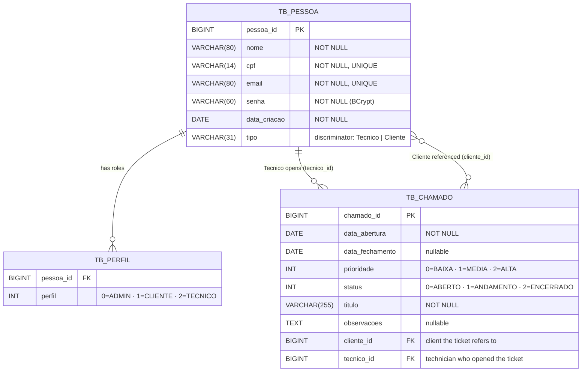
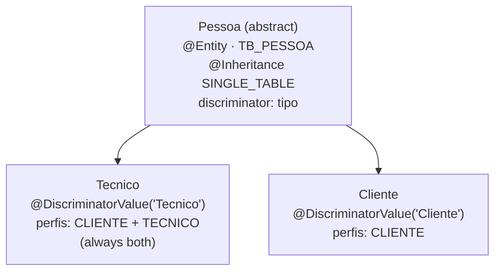

# Data Model

## Overview

The persistence layer uses **JPA with a SINGLE_TABLE inheritance strategy**. `Pessoa` is an abstract entity mapped to the table `TB_PESSOA`; both `Tecnico` and `Cliente` are concrete subclasses stored in the same table, differentiated by a discriminator column `tipo`.

Roles (perfis) are stored as a collection of integers in a separate join table `TB_PERFIL`, decoupled from the enum names to allow stable persistence across refactors.

---

## Entity-Relationship Diagram

> ⚠️ **Important:** only a `Técnico` can open a ticket (`POST /chamados` requires `ROLE_TECNICO`).
> The `cliente_id` field is a reference to the client the ticket is about — the client never creates tickets directly.
> Clients contact technicians via external channels (phone, e-mail, etc.), and the technician opens the ticket on their behalf.

---

## Inheritance Strategy

> **Key rule:** when a `Tecnico` is created via `TecnicoService`, both `Perfil.CLIENTE` (1) and `Perfil.TECNICO` (2) are added automatically — a technician is always also a client.

---

## Enums (stored as Integer)

All enums are persisted by their integer `codigo`, never by name. Mapping is always done via `XxxEnum.toEnum(Integer)`.

### Perfil

| Código | Constante | Descrição |
|---|---|---|
| 0 | `ADMIN` | `ROLE_ADMIN` |
| 1 | `CLIENTE` | `ROLE_CLIENTE` |
| 2 | `TECNICO` | `ROLE_TECNICO` |

### Prioridade

| Código | Constante |
|---|---|
| 0 | `BAIXA` |
| 1 | `MEDIA` |
| 2 | `ALTA` |

### Status

| Código | Constante | Behaviour |
|---|---|---|
| 0 | `ABERTO` | `dataFechamento` is `null` |
| 1 | `ANDAMENTO` | `dataFechamento` is `null` |
| 2 | `ENCERRADO` | `dataFechamento` = `LocalDate.now()` |

---

## Date Format

All `LocalDate` fields are serialized/deserialized as `"dd/MM/yyyy"` via `@JsonFormat(pattern = "dd/MM/yyyy")`.
