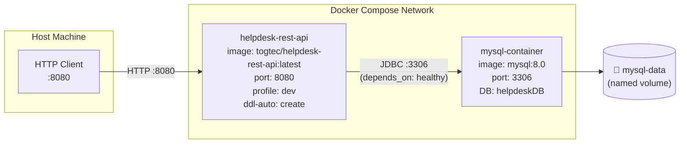
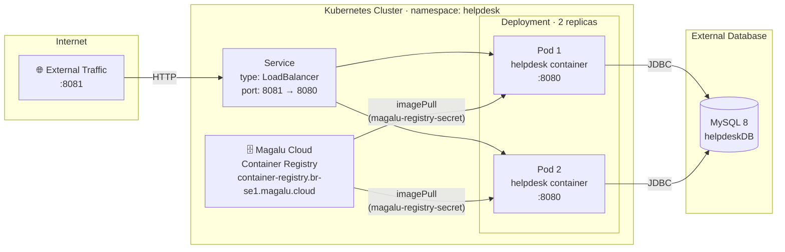
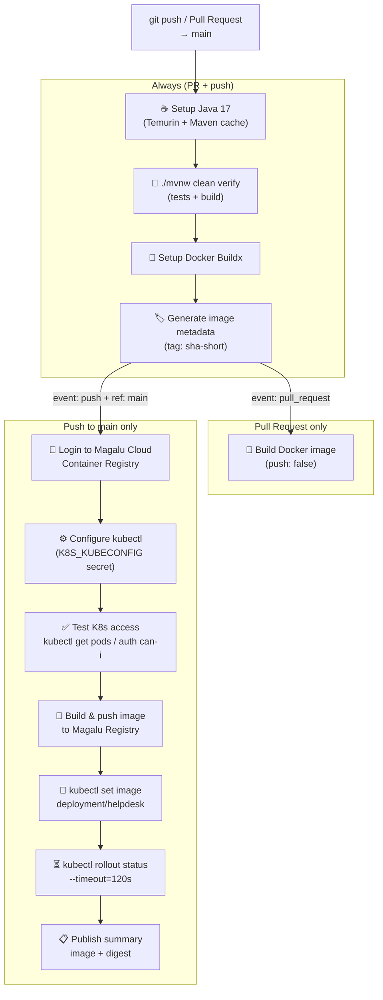

# Deployment

## Overview

The application supports two deployment modes:

| Mode | Description |
|---|---|
| **Docker Compose** | Local development / quick start with MySQL + API containers |
| **Kubernetes** | Production deployment on Magalu Cloud (2 replicas, LoadBalancer) |

The full CI/CD pipeline is automated via **GitHub Actions** (`.github/workflows/ci.yml`).

---

## Docker Compose

Starts two containers: `mysql-container` and `helpdesk-rest-api`. MySQL health is checked before the API container starts.

```bash
docker compose up -d
```



**Environment variables set by Compose:**

| Variable | Value |
|---|---|
| `SPRING_PROFILES_ACTIVE` | `dev` |
| `SPRING_DATASOURCE_URL` | `jdbc:mysql://mysql:3306/helpdeskDB` |
| `SPRING_DATASOURCE_USERNAME` | `helpdeskUser` |
| `SPRING_DATASOURCE_PASSWORD` | `admin` |
| `SPRING_JPA_HIBERNATE_DDL_AUTO` | `create` — recreates schema and seeds data on every start |

---

## Kubernetes (Magalu Cloud)

Production deployment in the `helpdesk` namespace. The API is exposed externally via a `LoadBalancer` service on port `8081` (forwarded to container port `8080`).



**Resource limits per pod:**

| | CPU | Memory |
|---|---|---|
| Request | `100m` | `256Mi` |
| Limit | `500m` | `512Mi` |

**Health probes:**

| Probe | Path | Behaviour |
|---|---|---|
| `startupProbe` | `/actuator/health` | 12 attempts × 5s — allows slow JVM startup |
| `livenessProbe` | `/actuator/health/liveness` | Every 10s after 30s delay — restarts unhealthy pods |
| `readinessProbe` | `/actuator/health/readiness` | Every 5s after 10s delay — removes pod from LB if not ready |

---

## CI/CD Pipeline (GitHub Actions)

The workflow in [`.github/workflows/ci.yml`](.github/workflows/ci.yml) runs on every `push` or `pull_request` targeting `main`.



**Required GitHub Secrets:**

| Secret | Description |
|---|---|
| `MGC_REGISTRY_USER` | Magalu Cloud Container Registry username |
| `MGC_REGISTRY_PASSWORD` | Magalu Cloud Container Registry password |
| `K8S_KUBECONFIG` | Full kubeconfig file content for cluster access |
